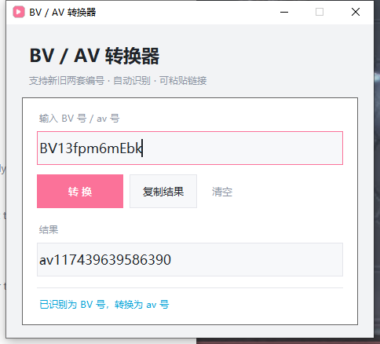

# BV / AV 转换器

B 站视频编号（**BV 号** ⇄ **av 号**）双向转换工具，带图形界面，单文件免安装。

支持 2026 年新版 BV 编号，同时对 2020 年的老视频依然正确。

---

## 下载

到 [Releases](../../releases) 页面下载 `bv-av-converter.exe`，双击即可运行，**不需要安装 Python**。

> 程序未做数字签名，首次运行 Windows 可能提示「已保护你的电脑」，
> 点「更多信息」→「仍要运行」即可。

---

## 功能

- **双向转换**：BV 号 ⇄ av 号
- **自动识别**：输入 BV 号就转 av 号，输入 av 号就转 BV 号，不用手动切换
- **支持链接**：可以直接粘贴 `https://www.bilibili.com/video/BV1xx.../` 这样的完整链接
- **边输入边转换**：输入框内容变化后自动出结果，也可以按回车
- **一键复制**：结果框点击即可全选，或点「复制结果」按钮
- **兼容新旧编号**：新版 47 位 av 号和 2020 年的老视频都能正确换算

---

## 截图



---

## 使用方法

1. 打开程序
2. 在输入框里输入、或粘贴以下任意一种：

   ```
   BV13fpm6mEbk
   av117439639586390
   117439639586390
   https://www.bilibili.com/video/BV13fpm6mEbk/
   ```

3. 结果会自动出现在下方
4. 点「复制结果」按钮复制

---

## 换算原理

B 站的两套编号是一一对应的，换算过程如下：

```
av → BV                       BV → av
─────────────────────         ─────────────────────
① 与掩码异或                   ① 去掉 BV1 前缀，反转
② 转成 9 位 58 进制            ② 交换第 2/8、4/7 位
③ 交换第 2/8、4/7 位           ③ 按 58 的权求和
④ 反转，前面加 "BV1"           ④ 与掩码异或
```

涉及三个常量：

| 常量 | 值 | 作用 |
|---|---|---|
| 字母表 | `FcwAPNKTMug3GV5Lj7EJnHpWsx4tb8haYeviqBz6rkCy12mUSDQX9RdoZf` | 58 进制字符集，去掉了易混淆的 `0 O I l` |
| 掩码 | `2275242641476827` | 打散连续编号，使其无法被顺序枚举 |
| 位数 | 9 位 | `58⁹ ≈ 7.4×10¹⁵`，足够覆盖到 53 位整数 |

> 注：2020 年流传的 6 位版本算法在 av 号超过约 380 亿（`58⁶`）后会算错，
> 本项目使用的是适配新编号的 9 位版本。

---

## 从源码运行

只依赖 Python 标准库（tkinter），无需安装任何第三方包。

```bash
python bv_aid_v2.py
```

要求 Python 3.8 及以上。

---

## 自己打包成 exe

```bash
pip install pyinstaller
pyinstaller --noconfirm --onefile --windowed --icon icon.ico --name bv-av-converter bv_aid_v2.py
```

或者直接双击 `build.bat`。

产物在 `dist/bv-av-converter.exe`。

---

## 已知限制

- `b23.tv` 短链接需要先在浏览器里展开成完整地址
- 输入格式不正确时会给出提示，不会崩溃

---

## License

[MIT](LICENSE)
